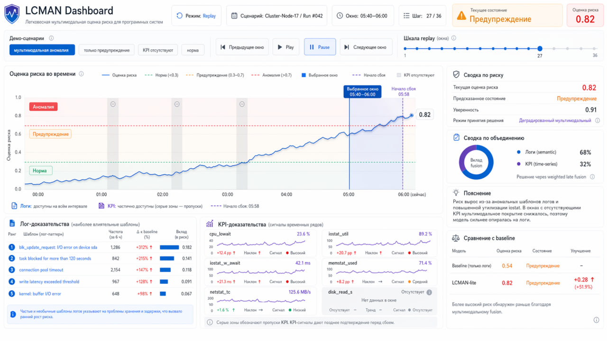
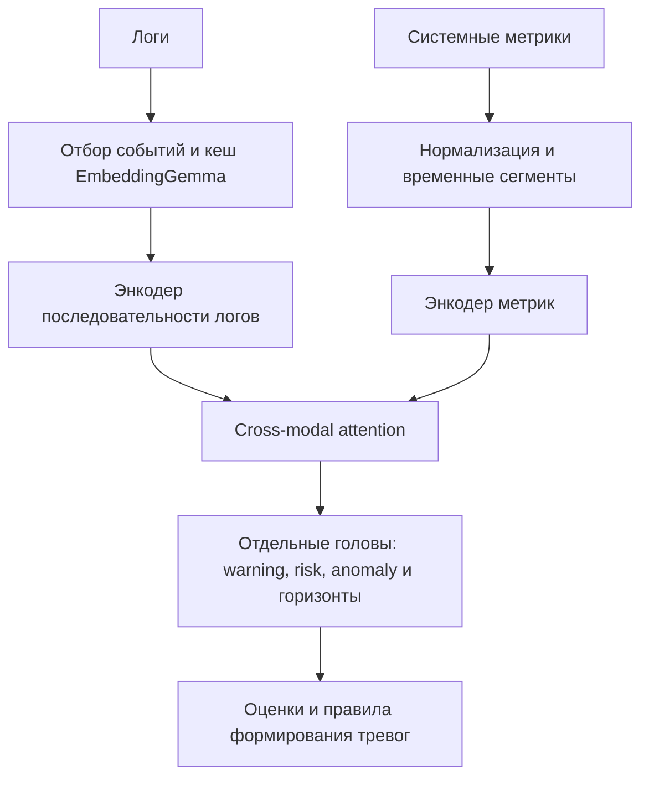

# Раннее предупреждение сбоев по логам и системным метрикам

Дипломный проект: исследование данных, обучение мультимодальной модели и Streamlit-дашборд для разбора её предупреждений. Задача — находить признаки приближающегося инцидента по двум источникам: сообщениям журналов и временным рядам CPU, памяти, диска и сети.

В репозитории сохранён путь от анализа данных до демонстрации: три ноутбука, код подготовки и обучения, checkpoint, ONNX-версии модели, результаты экспериментов и данные для воспроизведения сценариев в интерфейсе. Это исследовательский прототип; его качество и ограничения приведены ниже.

**С чего начать:** [запустить дашборд](#запуск-дашборда) · [посмотреть результаты](#результаты) · [открыть ноутбуки](#исследование) · [найти артефакты](docs/artifacts.md).

## Интерфейс



*Дизайн-макет из проекта, а не снимок работающего приложения. Текущая реализация находится в [dashboard/app.py](dashboard/app.py); состав и оформление экрана отличаются от макета.*

В приложении можно выбрать сценарий, пройти его по окнам времени и сопоставить оценку модели с логами, KPI и якорем события. Есть нормальные сценарии и сценарии деградации, управление воспроизведением и сведения о загруженных артефактах.

Приложение поддерживает два источника оценок:

- **Saved replay-store** — показывает сохранённые результаты эксперимента. Подходит для просмотра без повторного обучения и исходных данных.
- **Live forward pass** — выполняет модель на заранее подготовленных входных окнах. Это пошаговый инференс на сохранённом срезе, а не подключение к работающему серверу.

При наличии checkpoint и подготовленного среза приложение выбирает live-режим; иначе использует replay. ONNX-файлы включены в репозиторий как отдельные экспортированные версии: live-режим интерфейса использует PyTorch.

## Запуск дашборда

Команды выполняются из корня репозитория. Для окружения можно использовать Python 3.12 — эта версия указана в сохранённой команде финального обучения.

```bash
git clone https://github.com/VaSiluck/Diploma.git
cd Diploma
python -m venv .venv
```

Активировать окружение в Linux / macOS:

```bash
source .venv/bin/activate
```

В Windows PowerShell:

```powershell
.venv\Scripts\Activate.ps1
```

Установить зависимости интерфейса и запустить приложение:

```bash
python -m pip install --upgrade pip
python -m pip install numpy pandas scikit-learn torch streamlit plotly
python -m streamlit run dashboard/app.py
```

Адрес локального приложения — `http://localhost:8501`. PyTorch нужен даже для replay: модуль live-инференса импортируется при старте. В коде используются современные элементы Streamlit, в том числе `segmented_control`.

Артефакты уже включены в репозиторий. По умолчанию интерфейс читает `dashboard/artifacts/bundle`, а checkpoint и live-срез ищет также в `dashboard/artifacts/model/protocol_fixed_efficient_hades`. Для просмотра сохранённых сценариев каталог `raw_data/` не требуется.

Версии библиотек пока не зафиксированы lock-файлом. Приведённая установка описывает зависимости по коду; она не гарантирует идентичное окружение исходного обучения.

## Исследование

| Этап | Что находится внутри |
| --- | --- |
| [01 — исследование данных](01_eda.ipynb) | Структура источников, доступность логов и KPI, различия между нагрузками, распределение целевых каналов и предсобытийная динамика |
| [02 — pipeline и baseline](02_baseline_pipeline.ipynb) | Сборка единой таблицы окон, разбиение по запускам, простые модели, выбор порогов на validation и сохранение результатов |
| [03 — мультимодальная модель](03_fused_model.ipynb) | Архитектура, параметры финального запуска, сравнение с baseline, ложные тревоги, экспорт и проверка артефактов |

Ноутбуки содержат сохранённые результаты и доступны для чтения на GitHub. Полный повторный запуск требует дополнительных данных и зависимостей; условия приведены ниже.

### Данные и постановка

Единица наблюдения — временное окно внутри отдельного запуска нагрузки (`run_id`). Сводка сохранённого контракта: **2 883 окна, 228 запусков, 16 типов нагрузки**. KPI доступны в 97,1% окон, логи — в 57,4%, оба источника одновременно — в 54,5%. Поэтому наличие и отсутствие модальностей учитывается отдельно.

Подготовка данных выравнивает источники по времени и сохраняет происхождение окна, признаки, доступность модальностей и целевые значения. Для части событий якорь определяется по сигналу в логах, для части используется конец запуска как proxy. Качество такого якоря влияет на смысл раннего предупреждения.

В финальном запуске используется `stratified_by_workload`: разделение выполняется на уровне запусков внутри каждого типа нагрузки. Это оценка на новых запусках знакомых workload; она сама по себе не доказывает перенос на неизвестную нагрузку или другую инфраструктуру.

### Модель

Реализация следует HADES-подобной схеме объединения логов и метрик. В ней нет заявки на новую фундаментальную архитектуру.



Текстовые представления строятся через `google/embeddinggemma-300m` и кешируются. Метрики нормализуются с учётом workload; используются исходные значения и признаки отклонений. Модель выдаёт отдельные оценки для горизонтов 30, 60, 120 и 300 секунд, а также каналов warning, risk и anomaly.

Оценка модели не является откалиброванной вероятностью сбоя. Правила выдачи тревог — отдельный слой: порог, число последовательных срабатываний и пауза между уведомлениями меняют баланс обнаружений и ложных тревог.

## Результаты

Ниже — оконные test-метрики одного зафиксированного запуска: `efficient_hades`, `seed=43`, `stratified_by_workload`. Порог для каждой строки выбран на validation по `validation_best_f1`. Это не сводка по нескольким seed и не метрики эксплуатационной alert-policy.

| Горизонт | Precision | Recall | F1 | Average precision |
| --- | ---: | ---: | ---: | ---: |
| 30 с | 0,351 | 0,206 | 0,260 | 0,331 |
| 60 с | 0,450 | 0,578 | 0,506 | 0,510 |
| 120 с | 0,628 | 0,691 | 0,658 | 0,698 |
| 300 с | 0,777 | 0,712 | 0,743 | 0,832 |

Источник: [карточка эксперимента](dashboard/artifacts/model/protocol_fixed_efficient_hades/EXPERIMENT_CARD.md). Полные строки, включая политику ограничения ложных срабатываний, находятся в [comparison_metrics.csv](dashboard/artifacts/model/protocol_fixed_efficient_hades/comparison_metrics.csv).

На уровне запусков сохранённая сводка демонстрационного bundle содержит 31 аварийный и 14 нормальных запусков: доля обнаруженных аварийных запусков — **67,7%**, precision тревожных запусков — **72,4%**, медианное опережение — **66 секунд**. При этом доля нормальных запусков с ложной тревогой — **57,1%**. Эти значения относятся к политике bundle и не подменяют оконные метрики выше. Источник: [metrics_summary.csv](dashboard/artifacts/bundle/metrics_summary.csv).

Мультимодальная модель не выигрывает у простых моделей на всех каналах. Короткие горизонты остаются трудными, а частота ложных тревог пока слишком высока для самостоятельного эксплуатационного применения. Полезный результат работы — возможность проследить этот компромисс от данных и порогов до конкретного сценария в интерфейсе.

## Код и артефакты

| Каталог | Назначение |
| --- | --- |
| [dashboard/pipeline](dashboard/pipeline) | Чтение исходников, временное выравнивание и сборка контракта |
| [dashboard/training](dashboard/training) | Запуск baseline и финального обучения |
| [dashboard/modeling](dashboard/modeling) | Энкодеры, мультимодальная модель, подготовка входов и оценка |
| [dashboard/export](dashboard/export) | Сборка bundle для интерфейса |
| [dashboard/runtime](dashboard/runtime) | Чтение артефактов, инференс и подготовка данных экрана |
| [dashboard/ui](dashboard/ui) | Компоненты интерфейса и графики |
| [dashboard/artifacts](dashboard/artifacts) | Контракт, веса, конфигурации, отчёты и сохранённые сценарии |

Подробная [карта артефактов](docs/artifacts.md) объясняет, какие файлы нужны для демонстрации, откуда взяты метрики и что потребуется для повторного обучения.

## Повторение эксперимента

Для чтения отчётов и демонстрации достаточно включённых артефактов. Для пересборки данных, обучения и пересчёта текстовых представлений нужен исходный `raw_data/`, который **не включён в репозиторий**. Ссылка на его получение в текущей версии не зафиксирована, поэтому полный цикл по одному `git clone` пока не воспроизводится.

Ожидаемая структура источников: `raw_data/<workload>/mapred_logs/<scenario>.log` и `raw_data/<workload>/kpis/<scenario>/instruments/`. Парсер структуры находится в [build_contract.py](dashboard/pipeline/build_contract.py).

Дополнительные зависимости для ноутбуков, текстового энкодера и ONNX-экспорта:

```bash
python -m pip install jupyterlab matplotlib seaborn sentence-transformers onnx onnxruntime onnxscript
```

Первое построение текстовых представлений требует доступа к модели EmbeddingGemma и выполнения условий доступа её поставщика. Для CUDA потребуется соответствующая сборка PyTorch; `--device cpu` позволяет выбрать CPU.

После размещения исходных данных основные точки входа такие:

```bash
python -m dashboard.pipeline.build_contract --raw-data raw_data
python -m dashboard.training.baselines
python -m dashboard.training.final_model --device cpu
```

Эти команды создают или перезаписывают результаты в `dashboard/artifacts`. Параметры исходного финального запуска сохранены в [final_train_command.json](dashboard/artifacts/model/protocol_fixed_efficient_hades/final_train_command.json) и [run_config.json](dashboard/artifacts/model/protocol_fixed_efficient_hades/run_config.json). Абсолютные Windows-пути в старых manifest относятся к машине обучения; переносить их в свою команду не нужно.

Ноутбук `02` по умолчанию запускает сборку и обучение (`build_and_train`), поэтому выполнение всех ячеек без исходных данных завершится ошибкой. В `03` предусмотрено чтение сохранённых результатов и отдельный режим обучения с нуля. Некоторые промежуточные baseline-отчёты, на которые ссылаются ноутбуки, нужно сгенерировать заново — их нет в текущем снимке репозитория.

## Что осталось доработать

Ближайшие задачи — зафиксировать источник данных и окружение, повторить оценку на нескольких seed, проверить перенос между нагрузками и снизить число ложных тревог. Отдельно нужна сквозная проверка качества и задержки после ONNX/INT8-экспорта: наличие экспортированного файла ещё не подтверждает равенство результатов PyTorch и ONNX.

Проект разрабатывался с помощью Codex. Работа над ним показала, насколько важны единый протокол эксперимента, проверка промежуточных результатов и понятные границы между исследовательским кодом, моделью и демонстрацией.
